<!-- easy-suite:header:start -->
<p align="center">
  <a href="#easy-suite">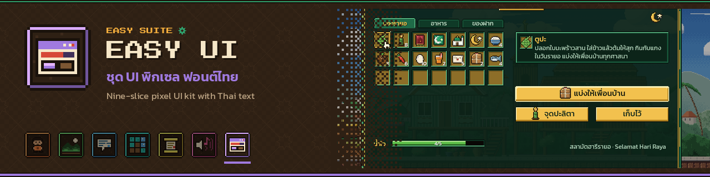</a>
</p>

<p align="center">
  <b>Easy UI</b> · ชุด UI พิกเซล ฟอนต์ไทย · Nine-slice pixel UI kit with Thai text<br />
  <sub>Part of <a href="#easy-suite"><b>Easy Suite</b></a>: Thai-friendly pixel-art game dev tools for Godot 4.3+ and PixiJS v8</sub>
</p>

<p align="center">
  <a href="https://github.com/Saladin2020/easyui/actions/workflows/ci.yml"></a> <a href="LICENSE"></a>  <a href="#export"></a> <a href="docs/MCP.md"></a> 
</p>

<p align="center">
  <a href="https://github.com/Saladin2020/easysprite"></a>
  <a href="https://github.com/Saladin2020/easyscene"></a>
  <a href="https://github.com/Saladin2020/easytilemap"></a>
  <a href="https://github.com/Saladin2020/easydialogue"></a>
  <a href="https://github.com/Saladin2020/easyquest"></a>
  <a href="https://github.com/Saladin2020/easyui"></a>
  <a href="https://github.com/Saladin2020/easysfx"></a>
  <a href="https://github.com/Saladin2020/easyfx"></a>
  <a href="https://github.com/Saladin2020/easymusic"></a>
  <a href="https://github.com/Saladin2020/easyanim"></a>
  <a href="https://github.com/Saladin2020/easyitems"></a>
  <a href="https://github.com/Saladin2020/easysave"></a>
  <a href="https://github.com/Saladin2020/easykit"></a>
</p>
<!-- easy-suite:header:end -->

# Easy UI

**ชุด UI พิกเซลสำหรับเกมหมู่บ้านไทย · ไม้สัก โคมแดง กระดาษสา ตลาดกลางคืน**  
Describe game screens in a small JSON format — nine-slice panels, buttons with every state, HP/MP bars,
inventory grids, hotbars, menus, sliders, tabs, tooltips — render them to PNG, edit them in a web editor, and
export a **Godot 4.3+ Theme** (StyleBoxTexture nine-slices + Kanit + ready-made `.tscn` screens) or a
**PixiJS v8 atlas** with small component helpers. Ships 30 procedural village item icons (Thai village + a Ramadan / Hari Raya set) and Thai text
with bundled Kanit. A sibling of [Easy Sprite](https://github.com/Saladin2020/easysprite),
[Easy Scene](https://github.com/Saladin2020/easyscene), [Easy Dialogue](https://github.com/Saladin2020/easydialogue)
and [Easy SFX](https://github.com/Saladin2020/easysfx).

[](https://nodejs.org)

> Easy UI **draws · lays out · exports**. Every frame and icon is generated from code (CC0), no image
> generation and no paid APIs; the CLI renders, the web editor, the Godot scenes and the Pixi helper all use
> the same pixels and the same layout rules, so what you see in the PNG is what you get in the engine.

<p align="center">
  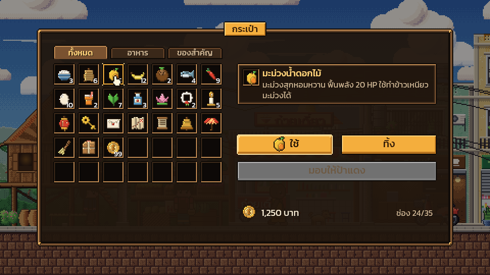
</p>

---

## What you get

| Frames | Widgets | Icons | Export |
| --- | --- | --- | --- |
| 5 styles — **teak** ไม้สัก, **lantern** โคมแดง, **paper** กระดาษสา, **night** ตลาดกลางคืน, **raya** รายอ (green and gold with 8-point star corners) — 25 parts each: panels, plate, buttons (normal / hover / pressed / disabled / focus), slots, bars, slider, checkbox, tabs, hand + arrow cursors, key badge | `panel label button menu bar inventory hotbar icon toggle slider tabs tooltip cursor image`; Thai word-wrap (Intl.Segmenter), focus hand cursor | 30 × 16 px: rice bowl, sticky-rice basket, mango, banana, coconut, fish, chili, lotus, Thai tea, lantern, garland, candle, bell, umbrella, map, scroll, letter, key, baht coin…, plus crescent and star, halal plate, ketupat (ตูปะ), pelita lamp, mosque and prayer mat (th + en names) | Godot 4.3+ project (Theme `.tres` per style, type variations, Kanit, one `.tscn` per screen, focus script), PixiJS v8 Spritesheet atlas + `easyui-pixi.js` + demo, PNG renders / sheets, JSON |

The demo doc `village` has seven screens over Easy Dialogue's village backgrounds: **title**, **hud**, **pause**
(lantern), **settings** (paper), **inventory**, a **shop** (night) and **raya** (raya style).

**Multicultural village · หมู่บ้านพหุวัฒนธรรม**: the samples share one southern Thai town where Buddhist,
Muslim and Chinese-Thai neighbours live side by side. The `raya` screen is a Hari Raya (รายอ) preparation bag
over Easy Scene's kampung mosque street. It holds ketupat (ตูปะ) to share with neighbours of every faith, pelita
lamps, a prayer mat, a halal plate and the crescent and star. The `raya` style is deep green and gold, with
8-point star (khatim / girih) corners and a dotted band. The icons use no Arabic script or sacred text, and the
halal plate is a generic crescent sign, not an official certification mark.

<p align="center">
  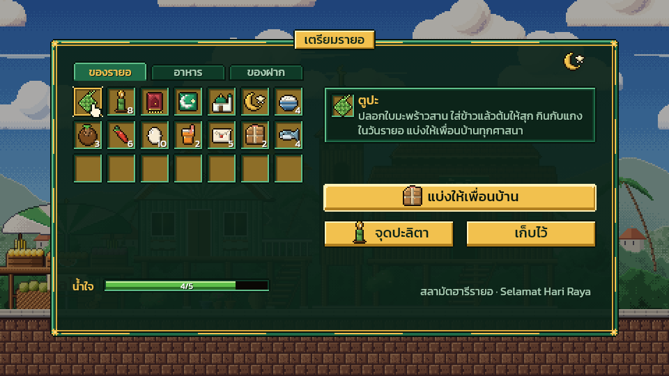
</p>

<p align="center">
  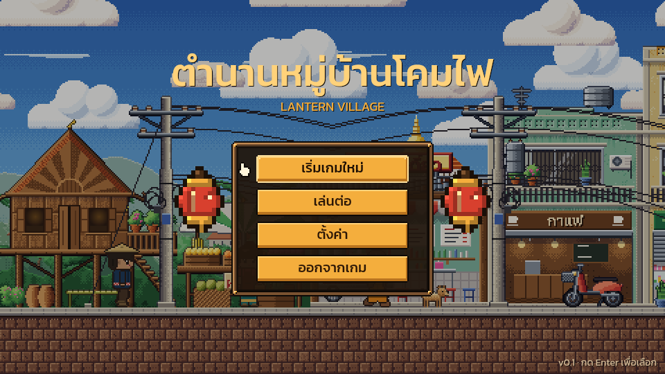
  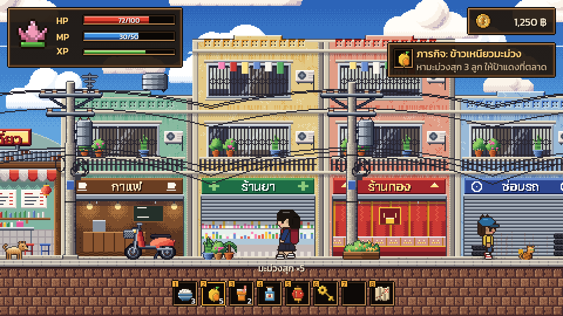
  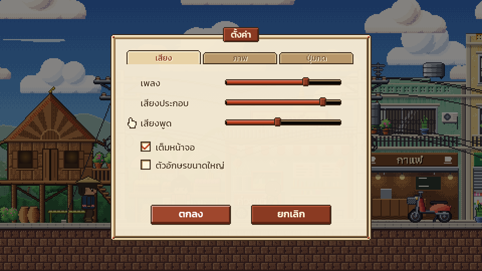
  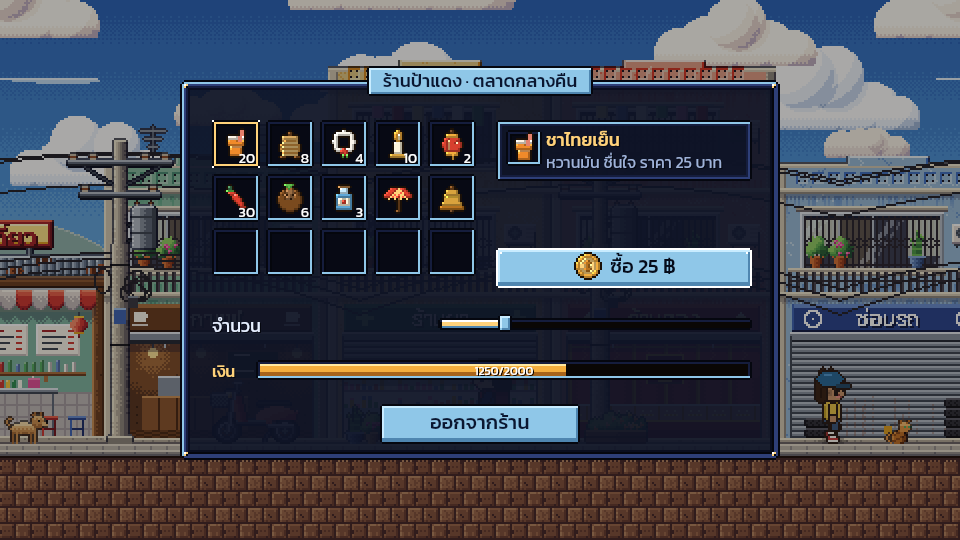
</p>

<p align="center">
  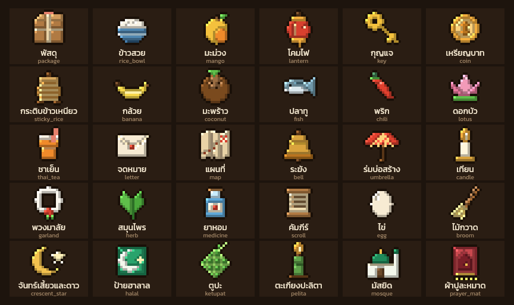
</p>


## Game menus (title · pause · settings · save slots)

`ui.gameMenu({ pages, start, onAction, onChange, onClose, text })` draws a full menu from plain page data and works with
the **keyboard** (↑↓ W S move, ←→ A D change, Enter Space E pick, Esc Backspace back) and **mouse / touch** (hover
selects, tap picks, tap the left third of a choice to step back, tap a slider where you want it). Rows are `action`
(optionally `to` another page), `choice` (`options`), `slider` (`min max step`) or `info` (help text). `rows` can be a
function, so a save page re-reads Easy Save slots every time it opens. Pass `text(str, {x, y, size, color, align})` to
draw labels with your own font (e.g. Easy Font bitmap text). The logic lives in `easyui-menu-core.js` (`MenuStack`,
engine-free and unit-tested); the Pixi export ships both files.

```js
const pause = ui.gameMenu({
  start: "pause", hint: "↑↓ เลือก · ←→ ปรับ · Enter ตกลง · Esc กลับ",
  pages: {
    pause: { title: "พักเกม", rows: [{ id: "resume", label: "เล่นต่อ" }, { id: "load", label: "โหลด", to: "load" }, { id: "settings", label: "ตั้งค่า", to: "settings" }] },
    load: { title: "โหลด", rows: () => saves.list().filter((s) => s.kind !== "auto").map((s) => ({ id: s.slot, label: s.exists ? s.meta.label : "ว่าง", disabled: !s.exists })) },
    settings: { title: "ตั้งค่า", rows: [{ id: "lang", label: "ภาษา", kind: "choice", options: [{ value: "th", label: "ไทย" }, { value: "en", label: "English" }, { value: "ms", label: "Melayu" }] }, { id: "volume", label: "เสียง", kind: "slider", value: 0.8 }] },
  },
  onAction: (row, m) => {}, onChange: (row, value) => {}, onClose: () => (pause.visible = false),
});
pause.bindKeys(window);
```

## Quick start

```bash
npm install
npx tsx src/cli.ts init --workspace ./my-ui       # screens/village.easyui.json + backgrounds/
npx tsx src/cli.ts serve --workspace ./my-ui      # editor → http://127.0.0.1:8838/
```

Dev mode: `npm run dev` (API on 8838) + `npx vite --config web/vite.config.ts` (UI on 5179).

The editor draws the screen live in the browser with the shared renderer: click a widget to select it, drag
to move, arrows nudge (Shift = 8 px), Delete removes; the inspector edits position, size, text, states, bar
values, icons (picker) or the raw widget JSON. Switch the screen style, background and dim; add screens and
widgets; validation is live; `Ctrl+S` saves; export buttons write the engine folders.

<p align="center">
  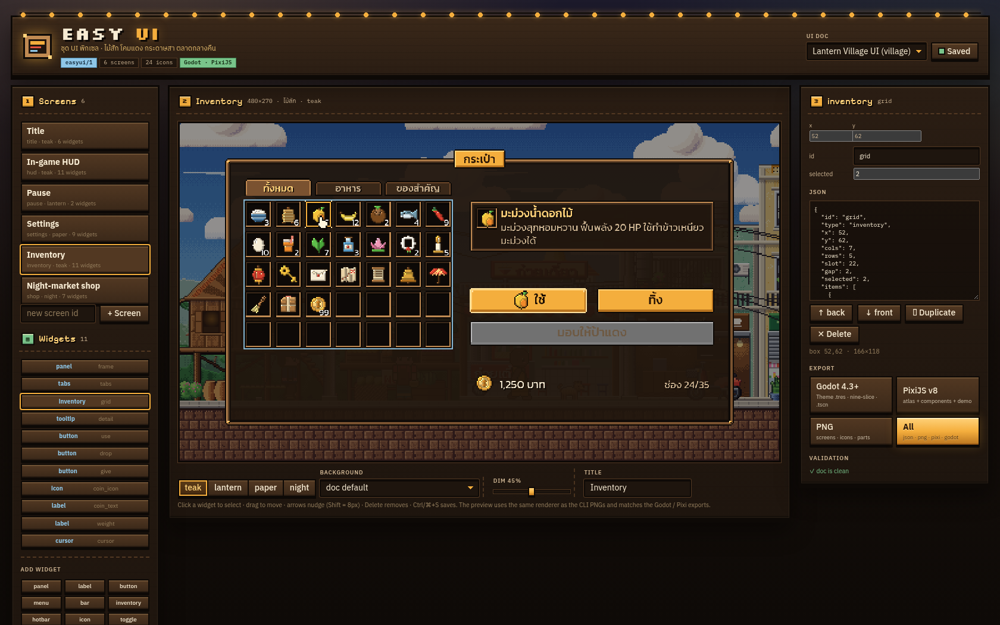
</p>

## CLI

```bash
easyui list --doc village                        # screens, styles, widget types
easyui render inventory --out inv.png --scale 3  # 1440×810 PNG
easyui render village:pause --style night --out pause-night.png
easyui icons                                     # names (th · en);  --out icons.png --styles styles.png
easyui check village                             # JSON-path errors + layout warnings; exit 1 on errors
easyui export --preset all                       # godot | pixi | png | json | all
easyui info · init · serve [--port 8838]
```

(`npx tsx src/cli.ts …` from a checkout, `node dist/cli.js …` after `npm run build`.)

## Screen format

```json
{
  "format": "easyui/1",
  "name": "Lantern Village UI",
  "style": "teak",
  "viewport": { "width": 480, "height": 270 },
  "background": "backgrounds/thai_village_street.png",
  "screens": {
    "pause": {
      "style": "lantern",
      "dim": 0.55,
      "widgets": [
        { "type": "menu", "x": 185, "y": 82, "w": 110, "title": "หยุดชั่วคราว",
          "items": ["เล่นต่อ", "กระเป๋า", "ตั้งค่า", "บันทึกเกม", "กลับหน้าหลัก"], "selected": 1, "disabled": [3] },
        { "type": "bar", "x": 20, "y": 20, "w": 80, "kind": "hp", "value": 72, "max": 100, "label": "HP", "showText": true },
        { "type": "hotbar", "x": 147, "y": 240, "slots": 8, "items": [{ "icon": "mango", "count": 5 }, null] }
      ]
    }
  }
}
```

Coordinates are viewport pixels; label `y` is the text baseline. Full reference: **[docs/FORMAT.md](docs/FORMAT.md)**.

<p align="center">
  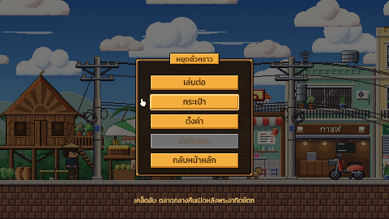
  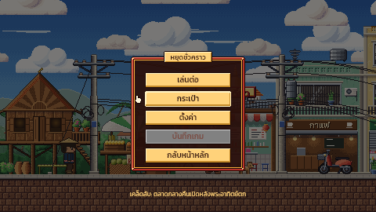
  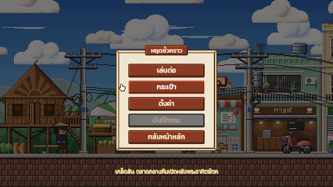
  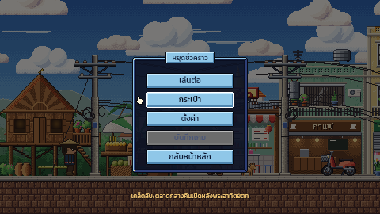
  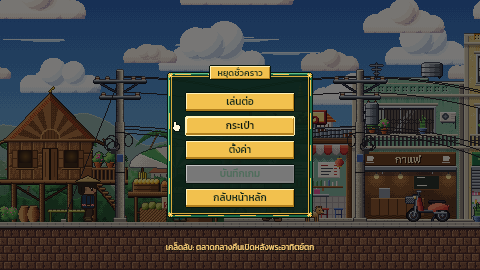
</p>

## Export

| Preset | Output (`exports/<doc>-<preset>/`) |
| --- | --- |
| `godot` | Godot 4.3+ project: `easyui/themes/{teak,lantern,paper,night,raya}.tres`, `easyui/textures/<style>/*.png`, `easyui/icons/*.png`, Kanit fonts, `easyui/easyui_screen.gd` (focus + hand cursor + demo nav) and `easyui_slot.gd`, `scenes/<screen>.tscn`, `project.godot` (480×270 viewport, 1440×810 window, `canvas_items` stretch, nearest filter, custom theme + cursor), `test_ui.gd`, `screenshot.gd` |
| `pixi` | `easyui.atlas.png` + `easyui.atlas.json` (PixiJS Spritesheet format; `meta.easyui` has nine-slice margins, colours, icon names), `easyui-pixi.js`, fonts, the doc, backgrounds and a demo `index.html` |
| `png` | `screens/*.png`, `icons.png`, `styles.png`, loose `icons/` and `parts/<style>/` PNGs |
| `json` | the doc |

**Godot 4.3+** — set `res://easyui/themes/teak.tres` as the project theme (or on any Control). Plain
Controls pick up the look; type variations give the rest:

| Control | Theme Type Variation |
| --- | --- |
| `Panel` | *(default)*, `PanelSmall`, `Plate` |
| `PanelContainer` | `Slot`, `SlotSelected` |
| `ProgressBar` | `HpBar`, `MpBar`, `XpBar`, `StaminaBar` |
| `Label` | `TitleLabel`, `MutedLabel`, `PlateLabel`, `CountLabel` |

`Button`, `CheckBox`, `HSlider` and `TabBar` are themed directly. The generated scenes are plain Controls you
can open and edit; Tab / Shift+Tab cycles them in the demo, Esc goes back.

<p align="center">
  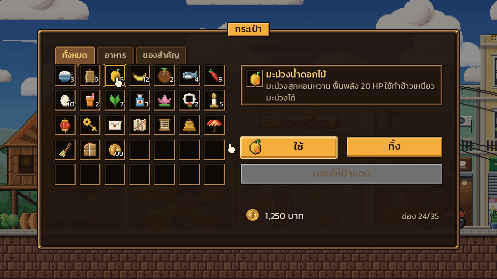
</p>

**PixiJS v8**

```js
import { loadUi } from "./easyui-pixi.js";
const ui = await loadUi(PIXI, "./easyui.atlas.json");                 // atlas + Kanit
app.stage.addChild(ui.panel({ x: 20, y: 20, w: 200, h: 120, title: "กระเป๋า" }));
const hp = ui.bar({ x: 30, y: 40, w: 80, kind: "hp", value: 72, max: 100, label: "HP", showText: true });
hp.set(50);
const inv = ui.inventoryGrid({ x: 30, y: 60, cols: 6, rows: 3, items: [{ icon: "mango", count: 5 }], onSelect: (i, it) => {} });
const screen = await ui.renderScreen(doc, "pause", { onAction: (a) => console.log(a) });   // whole screen
screen.bindKeys(window);                                                // ↑/↓/Enter menus · arrows grids · 1-8 hotbar
```

Create the app at the viewport size with `resolution: 3` so Thai text stays sharp.

## MCP

`npm run mcp` (stdio) or `npm run mcp:http` (`http://127.0.0.1:8839/mcp`). Tools: `workspace_info`,
`list_screens`, `get_screen`, `write_screen`, `render_screen`, `list_icons`, `export_ui`.
See **[docs/MCP.md](docs/MCP.md)**.

## Security

The server binds to `127.0.0.1` by default and rejects cross-origin writes and non-loopback `Host` headers.
`--host 0.0.0.0` requires the token printed at startup (or `EASYUI_TOKEN`). API and MCP paths stay inside
the workspace plus `EASYUI_ALLOWED_DIRS`; `/api/files` serves PNGs from the workspace only.

## Development

```bash
npm run typecheck && npm test && npm run build && npm run smoke
GODOT=/path/to/godot npx vitest run test/godot.test.ts       # import the export, instantiate every screen
npm run docs:images                                          # README renders
python3 scripts/check-pixi.py exports/village-pixi [shot]    # headless Chrome: every screen + keys + clicks
python3 scripts/capture-ui.py                                # editor screenshots (server on :8838)
xvfb-run -a godot --path exports/village-godot --script res://screenshot.gd   # Godot screenshots
```

Ports: API / editor 8838 · MCP HTTP 8839 · Vite 5179.

<!-- easy-suite:table:start -->
## Easy Suite


Thirteen small, local-first tools that share one look (teak, lantern gold, Kanit, 16/48px pixels), one
workflow (CLI · web editor · MCP server) and the same targets (**Godot 4.3+** and **PixiJS v8**).
ชุดเครื่องมือทำเกมพิกเซลสไตล์ไทย ใช้ร่วมกันได้ทั้งชุด · **Easy Kit** builds a whole playable game from the other twelve.  
The samples share one multicultural southern Thai village: Buddhist temple, wooden kampung mosque and
Chinese-Thai shrine on the same street. หมู่บ้านพหุวัฒนธรรม วัด มัสยิด ศาลเจ้า อยู่ร่วมกันในเมืองเดียว

| | Tool | What it does | Repo |
|:-:|---|---|---|
|  | [**Easy Sprite**](https://github.com/Saladin2020/easysprite) | Compose modular 48px chibi characters (top-down + side-view) and export sheets. | [`easysprite`](https://github.com/Saladin2020/easysprite) |
|  | [**Easy Scene**](https://github.com/Saladin2020/easyscene) | Side-view levels: parallax layers, 16px autotiles, Thai town props. | [`easyscene`](https://github.com/Saladin2020/easyscene) |
|  | [**Easy Tilemap**](https://github.com/Saladin2020/easytilemap) | Top-down 16px maps: blob-47 autotiles, objects, collision, spawns. | [`easytilemap`](https://github.com/Saladin2020/easytilemap) |
|  | [**Easy Dialogue**](https://github.com/Saladin2020/easydialogue) | Branching `.ezd` dialogue with Thai-safe text, portraits and choices. | [`easydialogue`](https://github.com/Saladin2020/easydialogue) |
|  | [**Easy Quest**](https://github.com/Saladin2020/easyquest) | Text `.ezq` quests: steps, flags, items, rewards, linked to dialogue. | [`easyquest`](https://github.com/Saladin2020/easyquest) |
|  | **Easy UI** ← you are here | Nine-slice pixel UI kit: panels, bars, inventory, menus, 30 icons. | [`easyui`](https://github.com/Saladin2020/easyui) |
|  | [**Easy SFX**](https://github.com/Saladin2020/easysfx) | Deterministic 8-bit SFX and 4-channel chiptune loops, typing blips. | [`easysfx`](https://github.com/Saladin2020/easysfx) |
|  | [**Easy FX**](https://github.com/Saladin2020/easyfx) | Pixel particles: sparks, fire, rain, lanterns, Raya pelita; sheets + Godot particles. | [`easyfx`](https://github.com/Saladin2020/easyfx) |
|  | [**Easy Music**](https://github.com/Saladin2020/easymusic) | Seeded Thai loop music: ranat, khong wong, saw, khim, pi, kompang; seamless WAV/OGG loops. | [`easymusic`](https://github.com/Saladin2020/easymusic) |
|  | [**Easy Anim**](https://github.com/Saladin2020/easyanim) | Cutscene timelines: actors, camera, dialogue, FX and music cues; Godot + Pixi runners. | [`easyanim`](https://github.com/Saladin2020/easyanim) |
|  | [**Easy Items**](https://github.com/Saladin2020/easyitems) | Item database, shops, inventory, loot tables and crafting; 44 starter items with pixel icons. | [`easyitems`](https://github.com/Saladin2020/easyitems) |
|  | [**Easy Save**](https://github.com/Saladin2020/easysave) | Versioned save slots with migrations and checksums; Thai / English / Malay string tables. | [`easysave`](https://github.com/Saladin2020/easysave) |
|  | [**Easy Kit**](https://github.com/Saladin2020/easykit) | One command drives all 12 tools into a playable Godot 4.3+ and PixiJS game; unified MCP server and `doctor`. | [`easykit`](https://github.com/Saladin2020/easykit) |

### Works with

- Uses the same four styles as **Easy Dialogue** and **Easy Quest** (teak, lantern, paper, night) and Kanit, plus its own **raya** style.
- Item icons fit **Easy Quest** items and rewards; screens sit over **Easy Scene** / **Easy Tilemap** backgrounds.
- Godot Theme `.tres` + `.tscn` screens and a PixiJS v8 atlas, like its siblings.
<!-- easy-suite:table:end -->

## Credits

All frames and icons are generated from code and CC0. Backgrounds from Easy Dialogue (CC0). Kanit © The
Kanit Project Authors (SIL OFL 1.1). See [CREDITS.md](CREDITS.md). Code: MIT © Salahuddin Benno.
